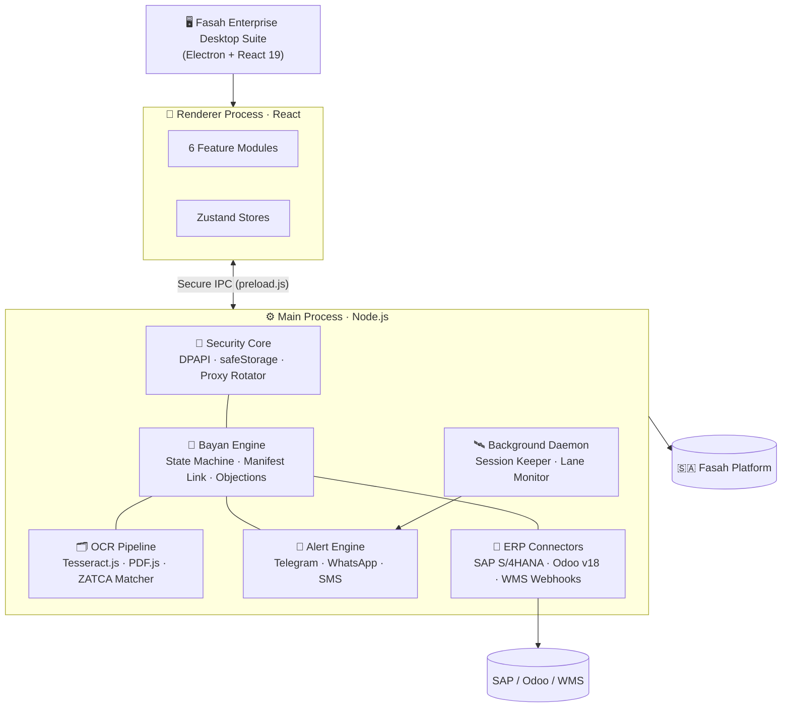
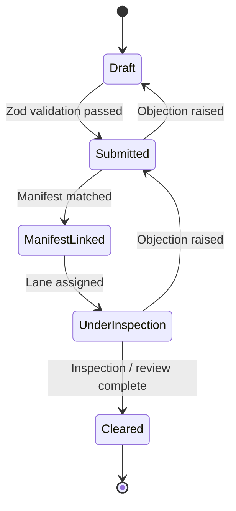

<div align="center">

# 🛡️ FASAH ENTERPRISE

### Autonomous Saudi Customs Automation & Clearance Platform

`v2.3.0 Stable` &nbsp;•&nbsp; `Enterprise Desktop Suite` &nbsp;•&nbsp; `ZATCA & SASO Compliant`

| Version | Electron | React | Vite | State | Styling | Security | Platform | License |
| :---: | :---: | :---: | :---: | :---: | :---: | :---: | :---: | :---: |
| `2.3.0` | `34.2.0` | `19.0.0` | `6.2.0` | `Zustand` | `Tailwind CSS` | `DPAPI + AES-256-GCM` | `Windows 10/11 x64` | `Proprietary` |

**A high-performance, enterprise-grade desktop platform that automates the Saudi _Fasah_ (فسح) customs workflow for
Customs Brokers, Freight Forwarders, Shipping Lines, and E-Commerce Importers.**

[Features](#-key-features) •
[Architecture](#-architecture) •
[Security](#-security-model) •
[Installation](#-installation--development) •
[Roadmap](#-roadmap) •
[FAQ](#-faq)

</div>

---

## 📑 Table of Contents

- [Overview](#-overview)
- [Key Features](#-key-features)
- [Capabilities & Guarantees](#-capabilities--guarantees)
- [Architecture](#-architecture)
- [Bayan Lifecycle Engine](#-bayan-lifecycle-engine)
- [Clearance Lane Monitor](#-clearance-lane-monitor)
- [Security Model](#-security-model)
- [Tech Stack](#-tech-stack)
- [Project Structure](#-project-structure)
- [Windows Installer](#-windows-installer-wizard)
- [Installation & Development](#-installation--development)
- [Configuration](#-configuration)
- [Scripts](#-available-scripts)
- [Roadmap](#-roadmap)
- [Contributing](#-contributing)
- [FAQ](#-faq)
- [License](#-license)

---

## 🌟 Overview

**Fasah Enterprise** replaces the repetitive, error-prone manual work of operating on the Saudi Fasah platform with a
single secure desktop suite. It manages broker accounts, handles verification challenges, tracks every Bayan
declaration through its lifecycle, extracts data from shipping documents with OCR, watches clearance lanes in real time,
and syncs the results with your ERP — all while keeping credentials strictly on the local machine.

| 🎯 Built For | ⚡ Outcome |
| :--- | :--- |
| Customs Brokers & Clearing Agents | Manage many client accounts from one encrypted vault |
| Freight Forwarders & Shipping Lines | Track declarations and lane status across ports in real time |
| E-Commerce Importers | Estimate landed cost and automate document handling |
| Logistics IT Teams | Plug clearance data into SAP S/4HANA, Odoo, or custom WMS |

---

## ✨ Key Features

### 🔐 1 · Accounts & Verification
- Multi-broker **account vault** with hardware-bound encryption (Windows DPAPI + AES-256-GCM).
- Guided **CAPTCHA** and **Absher / Nafath 2FA (OTP)** handling with explicit user prompts.
- Background **session keeper** that maintains active sessions 24/7.

### 📄 2 · Declarations (Bayan)
- Full **5-stage state machine** for every declaration.
- Manifest linking, objection handling, and port appointment management.
- Strict **Zod** schema validation before any payload is sent to Fasah.

### 🗂️ 3 · Document Center & OCR
- Extraction from **Commercial Invoices**, **Bills of Lading (B/L)**, and **SABER conformity certificates**.
- **Bi-directional Arabic / English** reading with line-item verification panels.
- Powered by Tesseract.js and a PDF.js parsing pipeline with ZATCA-style invoice matching.

### 🚦 4 · Tracking & Alerts
- Real-time **Green / Yellow / Red** lane detection.
- Instant multi-channel alerts: **Telegram, WhatsApp, SMS, Email**.

### 🔌 5 · Integrations
- Native sync adapters for **SAP S/4HANA** and **Odoo Enterprise v18**.
- Custom **REST webhooks** for WMS and in-house systems.
- Resilient networking: circuit breakers, sliding-window rate limiting, proxy rotation.

### 🧮 6 · Customs Tools
- **ZATCA landed-cost calculator**: customs duty (0%–25%) + 15% VAT.
- **Fuzzy HS Code search** over the Saudi Integrated Customs Tariff.
- Manual and automated **tariff bracket updates**.

---

## 🏛️ Capabilities & Guarantees

| 🟢 What It Provides | 🔴 What It Guarantees (Boundaries) |
| :--- | :--- |
| **Multi-Broker Account Vault** — manages multiple Fasah credentials with Windows DPAPI & AES-256-GCM encryption. | **No Cloud Credential Leaks** — credentials never leave the local machine or pass through unencrypted third-party relays. |
| **Verification Engine** — handles CAPTCHA challenges and Absher / Nafath OTP flows. | **No Unattended Human Bypassing** — security triggers always require explicit user interaction. |
| **Bayan Lifecycle Engine** — 5-stage monitoring: `Draft` ➔ `Submitted` ➔ `Manifest Linked` ➔ `Under Inspection` ➔ `Cleared`. | **No Unverified Submissions** — local Zod validation runs before anything reaches Fasah endpoints. |
| **OCR Document Pipeline** — extracts data from invoices, B/Ls, and SABER certificates. | **No Data Loss on Parsing** — bi-directional AR/EN reading with line-item verification panels. |
| **Lane Monitor** — real-time **Green** (instant release), **Yellow** (document review), **Red** (mandatory X-ray inspection). | **No Silent Lane Changes** — instant multi-channel alerts on every lane assignment. |
| **ERP & WMS Connectors** — bi-directional sync with **SAP S/4HANA**, **Odoo v18**, and REST webhooks. | **No Rate-Limit Bans** — sliding-window token bucket and proxy rotation prevent IP throttling. |
| **ZATCA Landed Cost & Tariff Calculator** — duty (0%–25%) + 15% VAT with fuzzy HS search. | **No Stale Rate Tables** — manual and automated tariff updates aligned with Saudi Customs regulations. |

---

## 🧱 Architecture



---

## 🔄 Bayan Lifecycle Engine



---

## 🚦 Clearance Lane Monitor

| Lane | Meaning | System Behaviour |
| :---: | :--- | :--- |
| 🟢 **Green** | Instant release | Notify user, mark declaration progress, sync to ERP |
| 🟡 **Yellow** | Documentary review | Alert user, surface required documents in Document Center |
| 🔴 **Red** | Mandatory X-ray bay inspection | High-priority alert on all channels, track inspection status |

---

## 🔒 Security Model

| Layer | Mechanism |
| :--- | :--- |
| **Credential storage** | Electron `safeStorage` (Windows DPAPI) + `keytar` |
| **Data at rest** | `@journeyapps/sqlcipher` encrypted database, AES-256-GCM |
| **Process isolation** | `preload.js` secure IPC bridge, minimal exposed surface |
| **Input validation** | Zod schemas before any outbound payload |
| **Network resilience** | Circuit breakers (`opossum`), sliding-window rate limiter, proxy agent |
| **Human-in-the-loop** | CAPTCHA / OTP always requires explicit user action |

> [!IMPORTANT]
> Credentials never leave the local client environment. Never commit `.env` files, vault databases, or exported
> credentials to version control.

---

## 🧰 Tech Stack

| Area | Technologies |
| :--- | :--- |
| **Desktop shell** | Electron 34.2.0 · Node.js 22 · Vite 6.2.0 |
| **Frontend** | React 19.0.0 · Zustand · Tailwind CSS |
| **Security & storage** | `@journeyapps/sqlcipher` · `safeStorage` (DPAPI) · `keytar` |
| **Resilience** | Axios · `opossum` circuit breakers · `rateLimiter.js` · Proxy Agent |
| **Document AI** | Tesseract.js · PDF.js |
| **Installer** | NSIS multi-step wizard (`installer-ui`) |

**Design system:** light off-white surface · `#0F766E` emerald primary · soft-gold alerts · `6px` radius.

---

## 📂 Project Structure

```text
fasah/
├── electron/                        # Main process & native Node services
│   ├── main.js                      # Lifecycle & window orchestrator
│   ├── preload.js                   # Secure IPC bridge
│   ├── daemons/
│   │   └── backgroundMonitor.js     # Session keeper & lane monitor (24/7)
│   └── services/
│       ├── keytarVault.js           # DPAPI-encrypted vault
│       ├── ocrEngine.js             # Document AI & parsing pipeline
│       └── erpService.js            # SAP S/4HANA & Odoo connectors
│
├── src/                             # Renderer process (React 19)
│   ├── common/                      # Reusable UI primitives
│   │   └── Modal · DataTable · StatusBadge · MetricCard
│   ├── layouts/                     # App shell: topbar & sidebar
│   ├── store/                       # Zustand stores
│   │   └── useAuthStore · useDeclarationStore · useSettingsStore
│   └── features/                    # 6 domain modules
│       ├── auth-accounts/           # Pillar 1 · Accounts & CAPTCHA/OTP
│       ├── declarations/            # Pillar 2 · Bayan & port appointments
│       ├── documents/               # Pillar 3 · Document center & OCR
│       ├── tracking/                # Pillar 4 · Lanes & alerts
│       ├── integrations/            # Pillar 5 · Fasah gateway & ERP
│       └── customs-tools/           # Pillar 6 · ZATCA calculator & HS lookup
│
├── installer-ui/                    # Branded 5-step installer wizard
└── package.json                     # Scripts & dependencies
```

---

## 📦 Windows Installer Wizard

The app ships as a branded 5-step NSIS setup wizard with feature previews and a live execution log.

```text
┌──────────────────────────────────────────────────────────────────────────┐
│ 🛡️  FASAH ENTERPRISE — INSTALLER v2.3.0                                  │
├──────────────────────────────────────────────────────────────────────────┤
│  [01] Welcome ► [02] License ► [03] Location ► [04] Installing ► [05] Done │
│                                                                          │
│  Extracting payload package & initializing components...                 │
│  ┌────────────────────────────────────────────────────────────────────┐  │
│  │ Initializing Fasah Enterprise installation engine...               │  │
│  │ Unpacking core desktop application & Electron framework...         │  │
│  │ Deploying DPAPI security vault & credential encryption...          │  │
│  │ Loading Bayan declaration workflows & port modules...              │  │
│  │ Extracting OCR engine & ZATCA invoice layout parser...             │  │
│  │ Indexing Saudi Integrated Customs Tariff (HS Codes)...             │  │
│  │ Configuring SAP S/4HANA & Odoo ERP connectors...                   │  │
│  │ Creating desktop shortcuts & finalizing setup...                   │  │
│  └────────────────────────────────────────────────────────────────────┘  │
│  [=========================================================>]  100%      │
└──────────────────────────────────────────────────────────────────────────┘
```

---

## 💻 Installation & Development

### Prerequisites

| Requirement | Version |
| :--- | :--- |
| Node.js | `v20.x` or `v22.x` |
| npm | `v10.x` |
| OS | Windows 10 / 11 (64-bit) |

### Quick Start

```bash
# 1. Clone
git clone https://github.com/your-username/fasah-enterprise.git
cd fasah-enterprise

# 2. Install dependencies
npm install

# 3. Run in development mode
npm run dev

# 4. Build the Windows installer (.exe)
npm run build:win
```

---

## ⚙️ Configuration

Create a local `.env` file (never commit it). The variable names below are examples — adjust them to match your code.

```env
# Alerts
TELEGRAM_BOT_TOKEN=
TAQNYAT_API_KEY=

# ERP
ODOO_URL=
ODOO_DB=
SAP_BASE_URL=

# Network
PROXY_LIST=
```

---

## 🧪 Available Scripts

| Command | Description |
| :--- | :--- |
| `npm run dev` | Start Vite + Electron in development mode |
| `npm run build:win` | Build the production Windows installer (NSIS) |

---

## 🗺️ Roadmap

- [x] Multi-broker encrypted vault
- [x] Bayan 5-stage lifecycle engine
- [x] OCR pipeline for invoices, B/L, and SABER certificates
- [x] Lane monitor with multi-channel alerts
- [x] SAP S/4HANA & Odoo v18 connectors
- [x] ZATCA landed-cost & HS lookup tools
- [ ] Automated test suite & CI pipeline
- [ ] Auto-update channel for installed clients
- [ ] Analytics dashboard (clearance times per port/lane)
- [ ] Full Arabic UI (RTL) localization

> Edit this list to match your real plan.

---

## 🤝 Contributing

1. Fork the repository
2. Create a feature branch: `git checkout -b feat/your-feature`
3. Commit using [Conventional Commits](https://www.conventionalcommits.org/): `git commit -m "feat: add ..."`
4. Push and open a Pull Request

---

## ❓ FAQ

<details>
<summary><b>Are my Fasah credentials sent to any server?</b></summary>

No. Credentials are encrypted locally with Windows DPAPI and AES-256-GCM and never leave the client machine.
</details>

<details>
<summary><b>Does it bypass CAPTCHA or OTP automatically?</b></summary>

No. Verification challenges always surface to the user for explicit action.
</details>

<details>
<summary><b>Which operating systems are supported?</b></summary>

Windows 10 / 11 (64-bit), because security relies on Windows DPAPI.
</details>

---

## 📜 License

Specify your license here (e.g. `Proprietary — All rights reserved` or `MIT`).

---

<div align="center">

### 🔒 Security & Compliance Notice

*Engineered to align with Saudi ZATCA & SASO digital integration guidelines. All automated tasks respect platform rate limits and security policies.*

**Fasah Enterprise** • Developed with excellence for Saudi logistics professionals.


</div>
